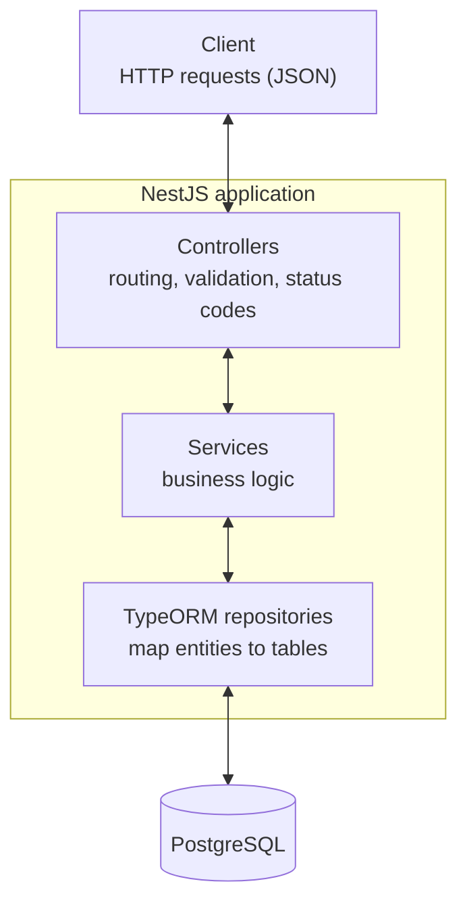
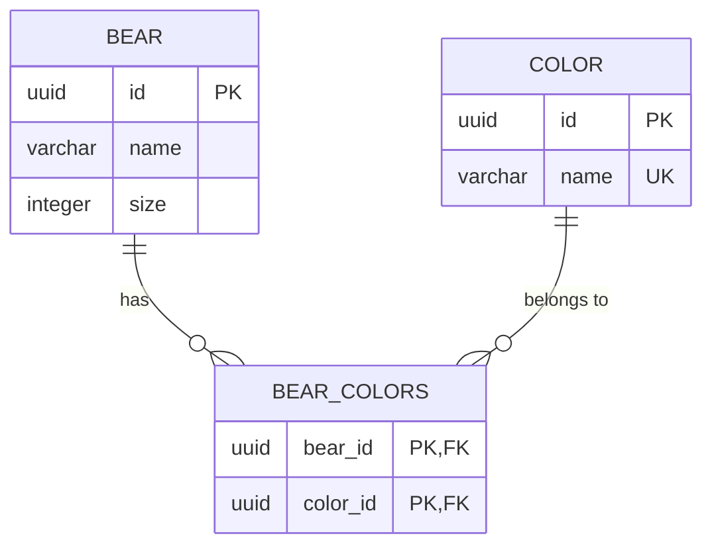

# Bear API

A REST API for managing bears and their colors, built with NestJS, TypeORM and PostgreSQL, following the instructions in [`TechnicalChallengeMidLevel.yaml`](./TechnicalChallengeMidLevel.yaml).

## Getting started

### With Docker

Requires [Docker](https://docs.docker.com/get-docker/). Starts the API and PostgreSQL:

```bash
docker compose up --build
```

The API is available at http://localhost:3000. Stop it with `docker compose down` (add `-v` to also delete the database volume).

### Locally

Requires Node.js 20.19+ and Docker (for PostgreSQL).

```bash
npm install
cp .env.example .env
docker compose up -d db
npm run start:dev
```

### Configuration

The application reads its configuration from environment variables (or a `.env` file, see [`.env.example`](./.env.example)):

| Variable | Default | Description |
|---|---|---|
| `PORT` | `3000` | HTTP port |
| `DB_HOST` | `localhost` | PostgreSQL host |
| `DB_PORT` | `5432` | PostgreSQL port |
| `DB_USERNAME` | `postgres` | PostgreSQL user |
| `DB_PASSWORD` | `postgres` | PostgreSQL password |
| `DB_NAME` | `bears` | Database name |
| `DB_SYNCHRONIZE` | `false` | Create/update tables from the entities on startup |

## Tests

```bash
npm test            # unit tests
npm run test:e2e    # end-to-end tests (requires PostgreSQL: docker compose up -d db)
npm run test:cov    # unit tests with coverage
```

- **Unit tests** cover the services, the exception filter and the request logger, with the database mocked.
- **End-to-end tests** start the full application and call every endpoint over HTTP against a real PostgreSQL database. They use a separate `bears_test` database, created by [`docker/postgres/init`](./docker/postgres/init) when the database volume is first created, and empty its tables before each test.
- **Coverage:** `npm run test:cov` reports around 49%, because it only measures the unit tests but counts every file, including the controllers (covered by the end-to-end tests) and files without logic (`main.ts`, modules, entities and DTOs). All the code is tested.

## API

| Method | Path | Description | Success |
|---|---|---|---|
| `GET` | `/colors` | List all colors | `200` |
| `POST` | `/colors` | Create a color | `201` |
| `GET` | `/bears` | List all bears with their colors | `200` |
| `POST` | `/bears` | Create a bear | `201` |
| `PUT` | `/bears` | Update a bear (name, size and/or colors) | `200` |
| `DELETE` | `/bears/{bearId}` | Delete a bear | `204` |
| `GET` | `/bears/{minimumSize}/{maximumSize}` | Bears with a size within the boundaries (inclusive) | `200` |
| `GET` | `/bears/{color}` | Bears that have the given color (by name) | `200` |

Example, to run in a terminal. The ids returned by the API are saved in shell variables and reused:

```bash
# Create the color brown (ignored if it already exists) and keep its id
curl -s -o /dev/null -X POST localhost:3000/colors \
  -H 'Content-Type: application/json' \
  -d '{"name":"brown"}'
COLOR_ID=$(curl -s localhost:3000/colors | sed -nE 's/.*"id":"([^"]+)","name":"brown".*/\1/p')

# Create a bear and keep its id
BEAR_ID=$(curl -s -X POST localhost:3000/bears \
  -H 'Content-Type: application/json' \
  -d '{"name":"Baloo","size":10}' | sed -nE 's/.*"id":"([^"]+)".*/\1/p')

# Give the bear the color
curl -X PUT localhost:3000/bears \
  -H 'Content-Type: application/json' \
  -d "{\"id\":\"$BEAR_ID\",\"colors\":[{\"id\":\"$COLOR_ID\"}]}"
# {"id":"...","name":"Baloo","size":10,"colors":[{"id":"...","name":"brown"}]}

# Find bears by color or by size
curl localhost:3000/bears/brown
curl localhost:3000/bears/5/20

# Delete the bear
curl -X DELETE localhost:3000/bears/$BEAR_ID
```

### Error responses

The specification only documents successful responses. Errors use standard HTTP status codes:

| Status | When |
|---|---|
| `400 Bad Request` | Invalid body or path parameter: missing or empty name, non-positive or non-integer size, malformed UUID, unknown fields, `minimumSize` greater than `maximumSize` |
| `404 Not Found` | The bear does not exist (`PUT`, `DELETE`), or a color id sent in `PUT /bears` does not exist |
| `409 Conflict` | Creating a color whose name already exists |
| `500 Internal Server Error` | Unexpected error (e.g. database unavailable). Details are logged, never returned to the client |

Error bodies follow the NestJS format:

```json
{ "statusCode": 400, "error": "Bad Request", "message": ["size must be a positive number"] }
```

### Logging

Every request is logged with its method, URL, status and duration (`warn` for 4xx, `error` for 5xx). Unexpected errors are logged with their stack trace and the request that caused them:

```
LOG   [HTTP] POST /bears 201 10.1ms
WARN  [HTTP] POST /colors 409 11.8ms
ERROR [AllExceptionsFilter] Unhandled error on GET /bears
ERROR [HTTP] GET /bears 500 2.9ms
```

## Architecture



## Database schema

Bears and colors have a many-to-many relation, stored in the `bear_colors` join table.



- A bear can have many colors, and a color can belong to many bears.
- Deleting a bear removes its rows in `bear_colors`.

## Assumptions

The specification leaves some points open or contradictory. These are the decisions taken:

- `PUT /bears` returns `200 OK` with the updated bear instead of `204`. The specification declares a `204` response containing a bear, but a `204` response cannot contain a body. Returning `200` keeps the documented response schema, which is what a client relies on.
- `PUT /bears` identifies the bear by the `id` in the request body, since the path has no id. Only the fields that are sent are updated (`name`, `size` and/or `colors`). When `colors` is sent, it replaces the bear's colors, and an unknown color id returns `404`. To add a color, send the current colors plus the new one. An empty list removes all colors.
- `GET /bears/{color}` takes the color name (e.g. `/bears/brown`). The specification types the parameter as an integer, but colors are identified by a UUID and have a unique name (the name keeps the URL readable). An unknown color returns an empty list.
- Color names are unique: creating a color that already exists returns `409 Conflict`.
- Color names are case-insensitive and stored in lowercase: creating `Brown` when `brown` exists returns `409`, and `GET /bears/Brown` returns the bears with `brown`.
- A bear's `size` must be a positive integer, and `GET /bears/{minimumSize}/{maximumSize}` returns `400` when `minimumSize` is greater than `maximumSize`. Both boundaries are inclusive.

## Project structure

```
src/
├── main.ts                  # Bootstrap: port, shutdown hooks
├── app.module.ts            # Config, TypeORM connection, request logging
├── app.setup.ts             # Global validation pipe and exception filter (shared with e2e tests)
├── colors/                  # Color entity, DTO, service, controller, unit tests
├── bears/                   # Bear entity (many-to-many with Color), DTOs, service, controller, unit tests
└── common/
    ├── filters/             # Global exception filter
    └── middleware/          # Request logger
test/                        # End-to-end tests
docker/postgres/init/        # Creates the bears_test database
```

## Possible improvements

- **Migrations:** tables are created with TypeORM's `synchronize`, which is convenient for this exercise but not safe for production. TypeORM migrations would make schema changes reviewable.
- **API documentation:** generate an OpenAPI/Swagger page from the controllers with `@nestjs/swagger`.
- **Pagination** for the list endpoints.
- **Health check endpoint** (`GET /health`) reporting whether the API and database are up, so a container platform can restart the app or stop sending it traffic when it isn't healthy.
