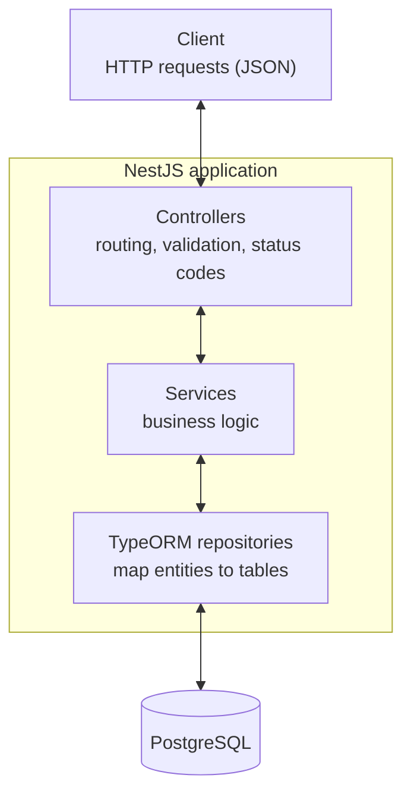
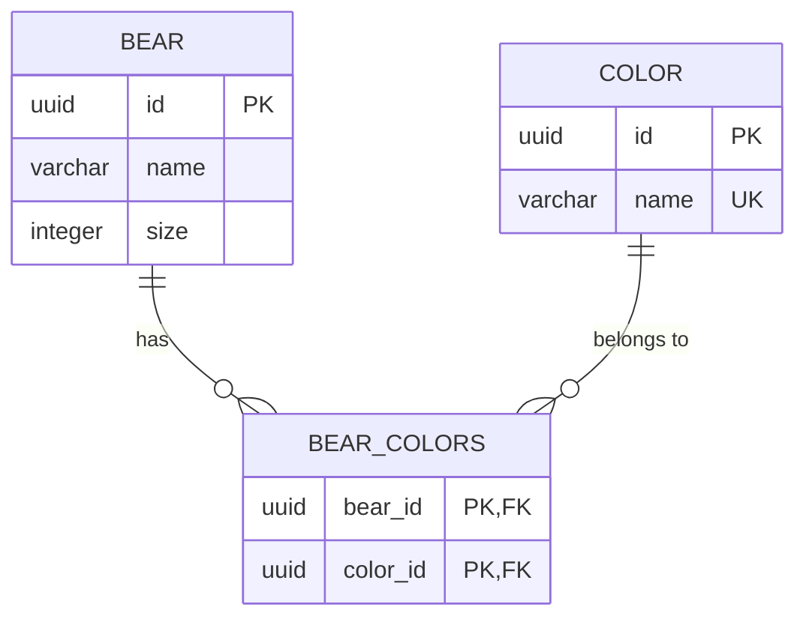

# Bear API

A REST API for managing bears and their colors, built with NestJS, TypeORM and PostgreSQL, following the instructions in [`TechnicalChallengeMidLevel.yaml`](./TechnicalChallengeMidLevel.yaml).

## Architecture

## Database schema

Bears and colors have a many-to-many relation, stored in the `bear_colors` join table.

- A bear can have many colors, and a color can belong to many bears.
- Deleting a bear removes its rows in `bear_colors`.

## Assumptions

The specification leaves some points open or contradictory. These are the decisions taken:

- `PUT /bears` returns `200 OK` with the updated bear instead of `204`. The specification declares a `204` response containing a bear, but a `204` response cannot contain a body. Returning `200` keeps the documented response schema, which is what a client relies on.
