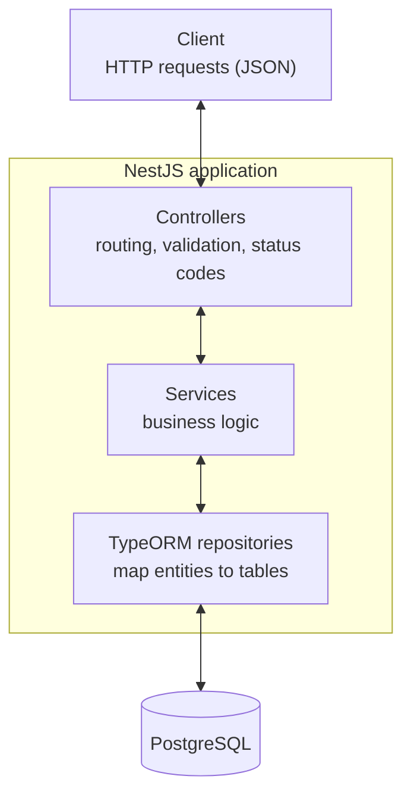
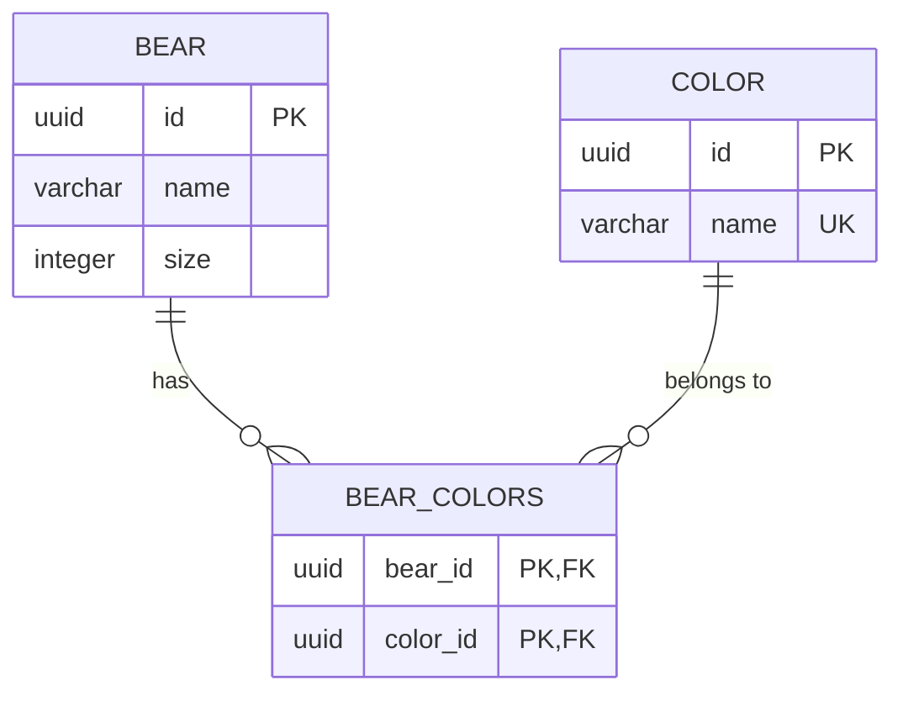

# Bear API

A REST API for managing bears and their colors, built with NestJS, TypeORM and PostgreSQL, following the instructions in [`TechnicalChallengeMidLevel.yaml`](./TechnicalChallengeMidLevel.yaml).

## Architecture

## Database schema

Bears and colors have a many-to-many relation, stored in the `bear_colors` join table.

- A bear can have many colors, and a color can belong to many bears.
- Deleting a bear removes its rows in `bear_colors`.

## Assumptions

The specification leaves some points open or contradictory. These are the decisions taken:

- `PUT /bears` returns `200 OK` with the updated bear instead of `204`. The specification declares a `204` response containing a bear, but a `204` response cannot contain a body. Returning `200` keeps the documented response schema, which is what a client relies on.
- `PUT /bears` identifies the bear by the `id` in the request body, since the path has no id. Only the fields that are sent are updated (`name`, `size` and/or `colors`). When `colors` is sent, it replaces the bear's colors, and an unknown color id returns `404`. To add a color, send the current colors plus the new one. An empty list removes all colors.
- `GET /bears/{color}` takes the color name (e.g. `/bears/brown`). The specification types the parameter as an integer, but colors are identified by a UUID and have a unique name (the name keeps the URL readable). An unknown color returns an empty list.
- Color names are unique: creating a color that already exists returns `409 Conflict`.
- A bear's `size` must be a positive integer, and `GET /bears/{minimumSize}/{maximumSize}` returns `400` when `minimumSize` is greater than `maximumSize`. Both boundaries are inclusive.
